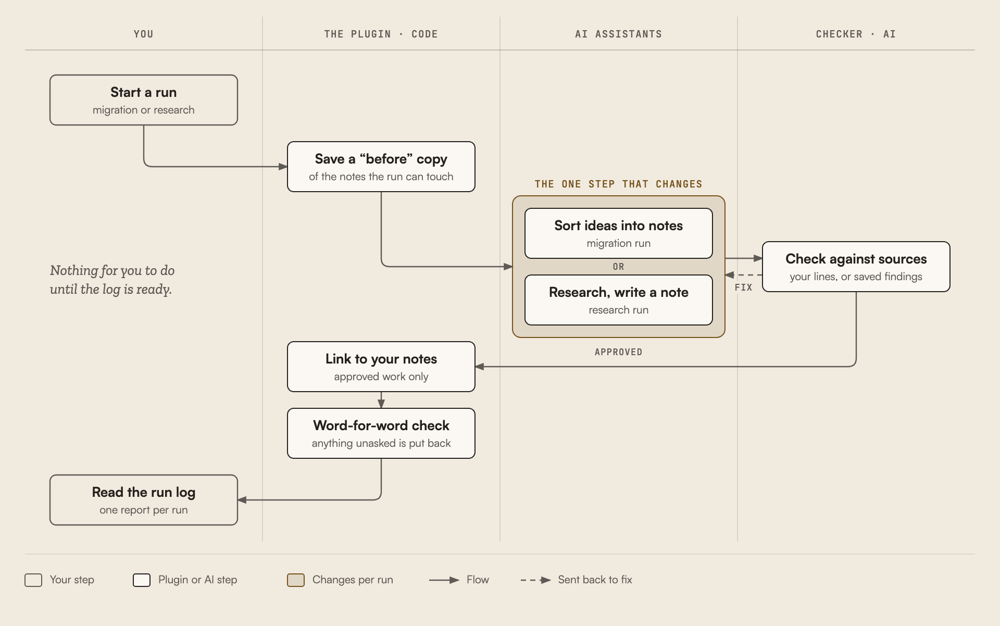
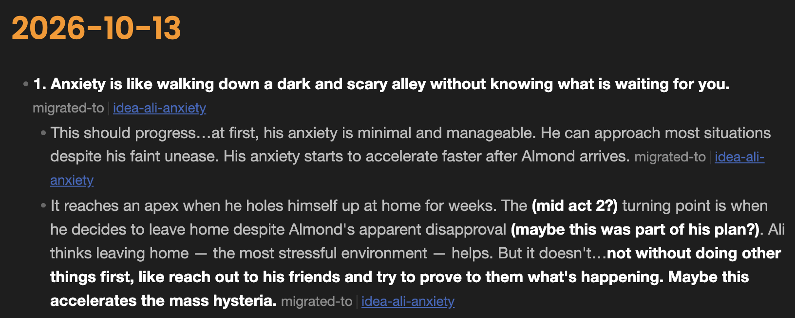
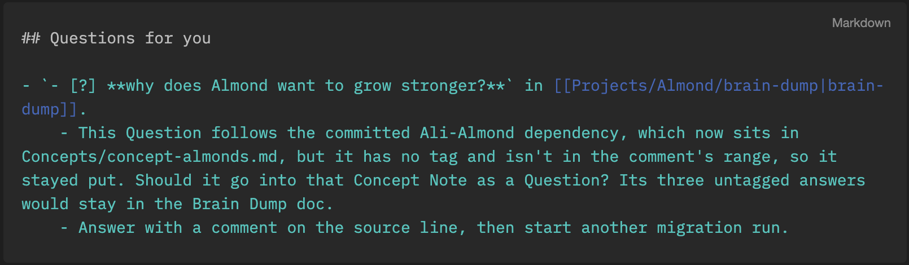

# Script Assistant

A Claude Code plugin that files a screenwriter's raw ideas into organized Obsidian notes and turns research questions into sourced notes. It doesn't write the script or come up with ideas.

> **Status: MVP snapshot.** This repo is the code behind the [Script Assistant case study](https://moesfrontmatters.com/projects/script-asst). It covers the pre-writing phase only: migration runs and research runs. It's shaped around my own writing workflow and isn't packaged for general use. A fuller public version is planned.



## What it does

The writer marks ideas in a running Brain Dump note with status tags (`#status/provisional`, `#status/committed`, `#status/rejected`), research requests (`- [r]`), and Obsidian comments. One command starts a run.

- **Migration run.** The `migrator` agent copies each marked idea into the right Idea Note or Area Note, and writes a record of every decision before it touches a note. The `migration-verifier` agent checks each batch against the writer's original lines without seeing the migrator's reasoning.
- **Research run.** A workflow script splits each request into topics. Researcher agents read sources and save passages, a writer agent drafts a footnoted note, and an evaluator agent checks every claim against its source.

Code, not a model, does the exact work: snapshots, pointers back to the source lines, the run log, and the **Edit guard**, which compares every note with its snapshot and flags any change nothing asked for.

| Brain Dump after a migration run | The run log's questions for the writer |
| --- | --- |
|  |  |

## Where to look

| To see | Open |
| --- | --- |
| The agents' instructions | [`agents/`](agents/) |
| The command the writer runs | [`skills/run/SKILL.md`](skills/run/SKILL.md) |
| The Run manager, which runs every step in order | [`lib/runmanager/`](lib/runmanager/), built against [`CONTRACT.md`](lib/runmanager/CONTRACT.md) |
| The Edit guard | [`lib/editguard/`](lib/editguard/) |
| The research workflow script | [`lib/research.js`](lib/research.js) |
| The permission hook that lets runs finish without prompts | [`hooks/scripts/run-permissions.py`](hooks/scripts/run-permissions.py) |
| The rulebook the migrator follows | [`references/migrator-rules.md`](references/migrator-rules.md) |
| Agent eval cases, and the recorded results | [`evals/`](evals/) and [`evals/results/`](evals/results/) |

## Tests and evals

Each code part's tests were written from its spec by one worker, and the code by another, until they passed.

- **354 Python tests** for the Run manager, Edit guard, and permission hook. They pass.
- **24 stand-in-agent tests** for the research workflow script. They pass.
- **Agent eval cases** in `evals/`, one folder per case, graded by code checks and model judges. A case counts as passing only when it passes 3 of 3 runs. Results and costs are in `evals/results/`, and the case study summarizes them.

To run the code tests from the repo root (Python 3 with [uv](https://docs.astral.sh/uv/), Node 26):

```bash
uv run --with pytest pytest lib/runmanager/tests lib/editguard/tests hooks/scripts
node lib/workflowtests/harness.mjs
```

## What it needs to run

The code tests run anywhere. A real run needs more:

- [Claude Code](https://claude.com/claude-code), with this folder installed as a plugin
- An Obsidian vault arranged as the plugin expects: a Brain Dump note, Idea Notes, Area Notes, and the status tags above
- A project folder set up with `/script-asst:run init`

The note system is documented in the case study, not here. This snapshot doesn't include setup guides.

## Not in this snapshot

- The writing phase: a script parser, story graph, and ripple report. These are designed, and the parser exists as a separate package.
- A Review run that checks existing notes against a change. It's designed, not built.

## Credits

Designed and directed by Moe Abbas. Claude Opus 5.5 workers wrote the code and tests from my specs, and I designed the evals that gate each part.

## License

[MIT](LICENSE)
